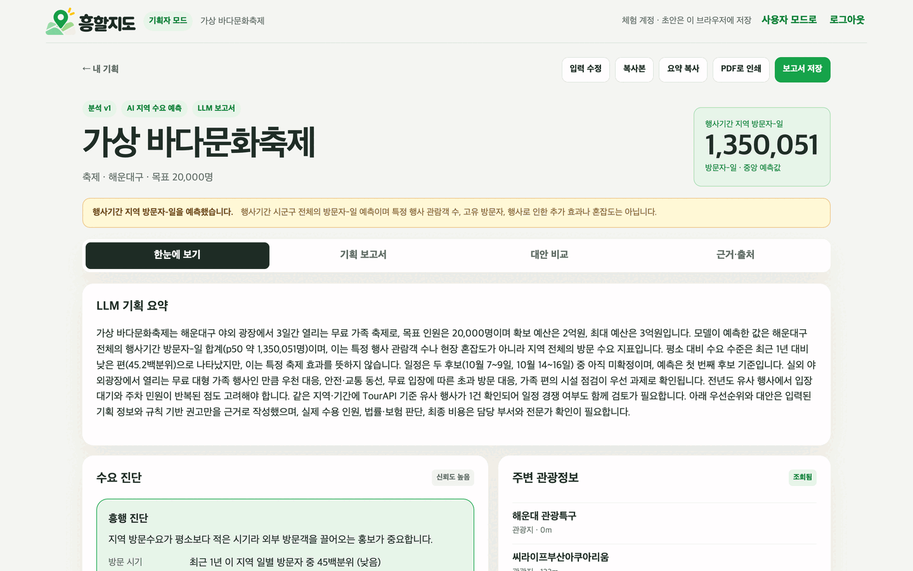
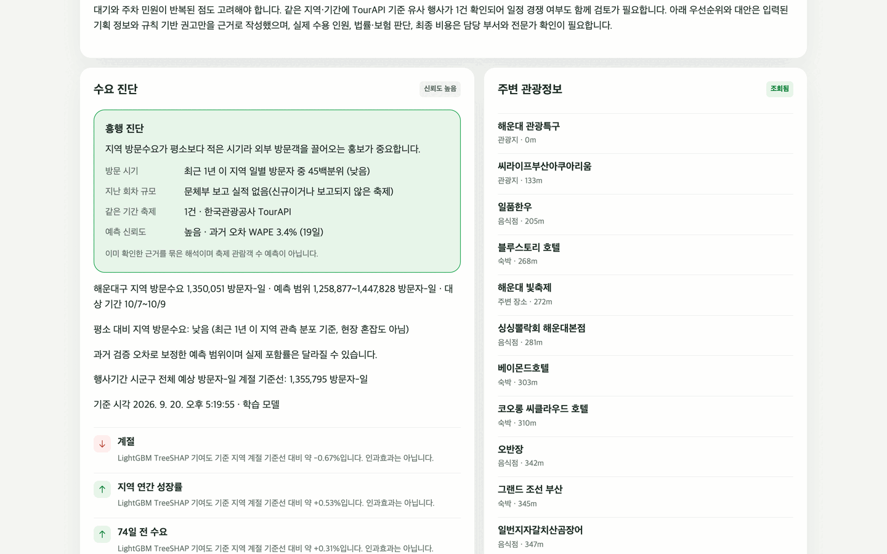
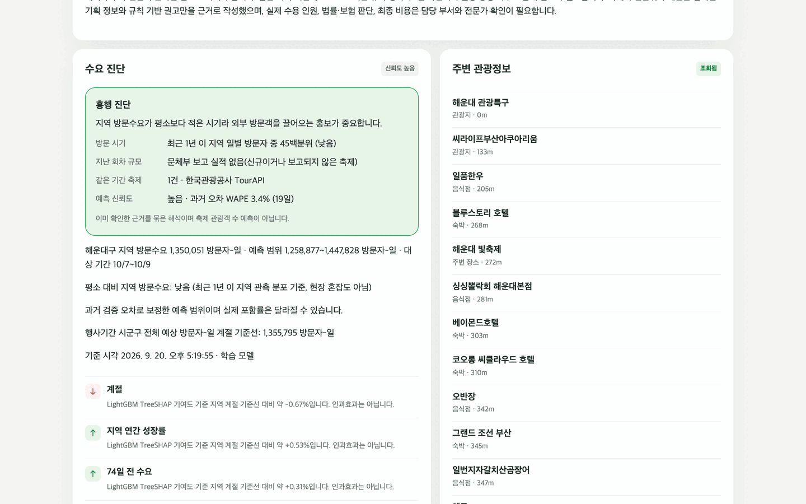
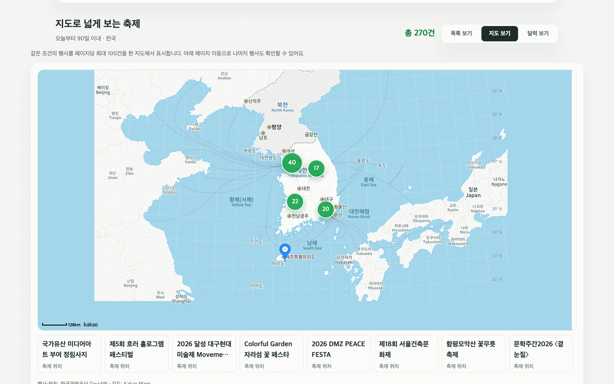

<p align="center">
  
</p>

<h3 align="center">🏅 Excellence Award, 2026 Korea Tourism Data Contest</h3>

<p align="center">
  <a href="https://github.com/ghdtjdwn/heungmap/actions/workflows/ci.yml"></a>
  <a href="LICENSE"></a>
  &nbsp;·&nbsp; <a href="README.md">한국어</a> | English
</p>

# HeungMap (흥할지도)

A web service that predicts regional visitor demand around festival dates from Korea Tourism Organization
OpenAPI (TourAPI) data and regional visitor statistics, and serves the same prediction to festival planners and visitors.
Excellence Award winner in the web/app track (designated task 9, festival success prediction) of the 2026 Korea Tourism Data Contest.

- Live: [heungmap.vercel.app](https://heungmap.vercel.app) — the visitor pages open without login; planner analysis needs Google sign-in.
- Model at a glance: [model card (ko)](docs/MODEL_CARD.md)

## Screens

| Planner: predicted demand range | Planner: success diagnosis |
| --- | --- |
|  |  |
| **Planner: TreeSHAP factors** | **Visitor: festival map** |
|  |  |

Captured with Playwright on 2026-09-20 against the real backend, the adopted model (`regional-daily-1.0-ab975d661247`)
and live TourAPI responses. Not mock-ups. All 30 captures: [docs/assets/submission-20260921/final](docs/assets/submission-20260921/final/README.md).

## What it predicts

Using only information available **30 days before** an event, the model predicts the p10·p50·p90 range of
**visitor-days for the whole sigungu (district)** during the event period. It does not invent attendance for a
specific festival or on-site crowding. Reported previous-year attendance (Ministry of Culture, Sports and Tourism)
is shown separately as an actual value, and the two are combined with the number of competing TourAPI festivals and a
per-district reliability grade into a "success diagnosis".

| Metric (temporal holdout 2026-08-01~19, 4,959 district-days) | WAPE | Median abs. ratio error | Within ±20% |
| --- | ---: | ---: | ---: |
| Seasonal + growth baseline | 4.256% | 3.514% | 97.24% |
| **Adopted model** (baseline + LightGBM residual correction) | **3.939%** | **3.344%** | 97.20% |

A frozen-model forward evaluation on unseen dates (08-16~19) gave WAPE 4.43% (baseline 4.98%). Only a model that
passes all five pre-registered adoption criteria is served; factor contributions come from LightGBM TreeSHAP.

## Stack

- Web: Next.js App Router, TypeScript, Kakao Maps SDK — deployed on Vercel
- API: FastAPI, Pydantic, single OpenAPI 3.1 contract in `contracts/openapi.yaml`
- Model: pandas, LightGBM; adopted artifacts are checksum-verified before loading
- LLM: Claude (or the local Ollama default in `.env.example`) writes the planner report; the server rejects numbers or claims not present in the input and falls back to a rule-based report
- Operations: FastAPI runs as a systemd service on a self-hosted Oracle VM behind Tailscale Funnel and retrains daily as new visitor data is published ([runbook, ko](docs/DEPLOY_RUNBOOK.md))

## Run locally

Python 3.11+, Node.js 20.9+.

```bash
cp .env.example .env            # TourAPI / visitor-data / Kakao keys; LLM defaults to local Ollama
python3 -m venv .venv
brew install libomp             # macOS: needed by LightGBM
.venv/bin/pip install -r backend/requirements-dev.txt -r backend/requirements-model.txt
PYTHONPATH=backend .venv/bin/uvicorn app.main:app --reload --port 8000
```

```bash
cd frontend && npm install && npm run dev      # http://localhost:3000, mock login by default
```

Model artifacts are not in Git; rebuild them with the [reproduction steps (ko)](docs/MODEL_EVALUATION.md).

```bash
PYTHONPATH=backend .venv/bin/python -m pytest backend/tests -q   # 172 passed, isolated from external APIs
cd frontend && npm run typecheck && npm run lint && npm run build
```

## Limits

- Predictions are district-wide visitor-days, not attendance, crowding, ticket demand or the causal effect of a festival.
- About 1.5 years of visitor history: holidays and extreme weather are under-represented.
- Only events starting within 30 days (or in progress) are predicted, for up to 30 remaining days. Districts created by the
  July 2026 administrative reorganization are skipped until a year of history exists.
- If visitor data publication or retraining stalls, the predictable window shrinks; check `days_until_stale` at `GET /api/v1/system/model-status`.

## License

Code is [MIT](LICENSE). TourAPI, Korea Tourism Data Lab, MCST and Kakao data follow their own terms and are not included in the repository.
